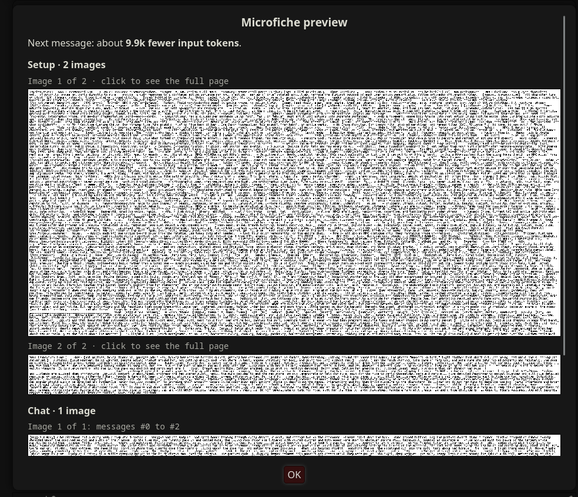

# Microfiche: cut input costs by up to 80%

Microfiche sends roleplay text as images to cut input tokens and save money in SillyTavern.

Tested on Gemini Argon. Claude, GPT and other vision models are opt-in and untested: enable the selected model in **Advanced → Other models (experimental)**.

## How does it work

Raw tokens are expensive. Gemini [bills images by resolution](https://aistudio.google.com/docs/image-understanding#token-calculation) and can read the text in them well, so a full image can use roughly 20× fewer input tokens at Low, 10× at Medium and 5× at High than sending that text normally.

Same story, 30 questions about what happened:

| Story sent as | Story facts recalled (30-question test) | Full-page input cost saved (before overhead/caching) |
|---|---:|---:|
| Normal text | 30/30 (100%) | — |
| Microfiche Low | 21/30 (70%) | About 95% |
| Microfiche Medium | 29/30 (97%) | About 90% |
| Microfiche High | 29/30 (97%) | About 80% |

## How much can it save?

Longer chats save more.

Monthly bill estimates on Argon with **preset, character card, persona, active lorebook and older chat sent as images**: 25k setup tokens, 4k newest text, 60 replies/swipes a day (30 for the uncut chat). Percentages compare against cached text.

| How you RP | No caching | Caching | Low + caching | Medium + caching | High + caching |
|---|---:|---:|---:|---:|---:|
| New chat at 10k | $158 | $112 | $64 (**43% saved**) | $66 (**41% saved**) | $72 (**35% saved**) |
| New chat at 20k | $176 | $122 | $65 (**47% saved**) | $69 (**44% saved**) | $77 (**37% saved**) |
| New chat at 30k | $194 | $132 | $66 (**50% saved**) | $70 (**47% saved**) | $79 (**40% saved**) |
| Branch at 30k | $220 | $147 | $67 (**54% saved**) | $73 (**50% saved**) | $84 (**43% saved**) |
| Keep one chat | $654 | $385 | $51 (**87% saved**) | $71 (**82% saved**) | $110 (**71% saved**) |

## Which quality?

| Quality | Input tokens without Microfiche | Input tokens with Microfiche | Input cost saved (before overhead/caching) | Story facts recalled (30-question test) |
|---|---:|---:|---:|---:|
| Low | About 5,500 tokens | About 280 | About 95% | 70% |
| Medium | About 5,500 tokens | About 560 | About 90% | 97% |
| High | About 5,500 tokens | About 1,120 | About 80% | 97% |

These quality settings apply to Gemini; Medium is the default. Low costs less but missed more story details in this test; High gives the image more tokens. Partly filled pages save less. Other models use PNGs and an adjustable token estimate.



## Install

In SillyTavern, go to **Extensions → Install extension** and paste:

```text
https://github.com/cata02222/SillyTavern-Microfiche
```

## Keep specific preset prompt

Put this anywhere in a preset prompt to keep that prompt as text:

```html
<!-- microfiche:keep -->
```

## Limits

- Requires Chat Completion and a model that accepts images. Other models are experimental; recall and actual image costs have not been tested.
- On AI Studio and Vertex, Low is sent as Medium.
- Assistant-role prompts and prompts or lorebook entries inserted inside chat history stay as text.
- Names, numbers and exact quotes can drift when read from images.
- Actual savings depend on your prompt, chat length, settings, caching and provider.

# License

AGPL v3.0 ([LICENSE](LICENSE)).

Font: Spleen 5×8 by Frederic Cambus, BSD 2-Clause (`licenses/LICENSE-spleen`).
Emoji names: Unicode Emoji 17.0 (`licenses/LICENSE-unicode`).
